# Prototype Pipeline — Architecture

A Markdown spec uploaded to S3 is turned into a **working HTML prototype** by a
coding agent running in a Kata micro-VM, and published as a presigned link. No
GitHub, no human in the loop, and **no AWS credentials inside the VM**.

All diagrams are Mermaid and render on GitHub. Every component shown was verified
on a live `oap-hub` cluster in account `818947917436` / `us-west-2`.

Companion to [`README.md`](./README.md) (the GitHub-issue pipeline this reuses)
and the chart reference in
[`gitops/addons/charts/dark-factory/README.md`](../../gitops/addons/charts/dark-factory/README.md).

---

## 1. System context

Where the pipeline sits in the platform. Everything in blue is pre-existing OAP;
green is added by `docPipeline`.

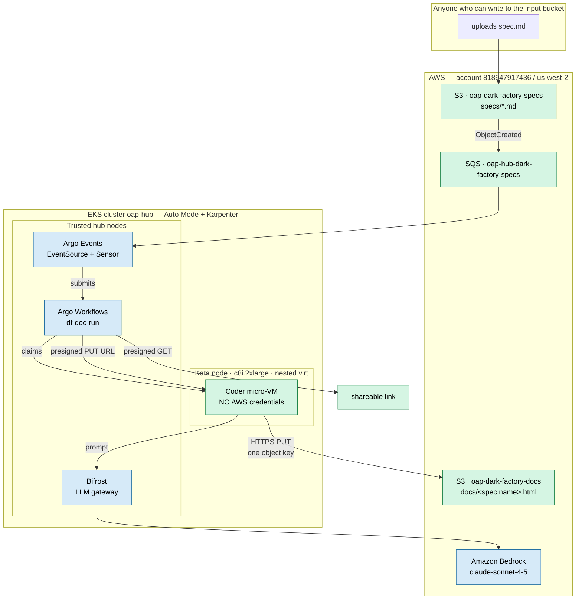

Both buckets are **private** — all four public-access-block flags true, SSE-AES256.
The only way out is a presigned URL.

---

## 2. Runtime flow — upload to link

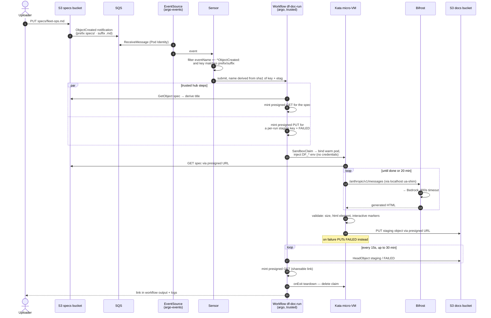

The hub polls S3 as the **completion bus**. In the GitHub pipeline that role is
played by GitHub itself; here S3 is the only channel the VM can write to.

---

## 3. Workflow DAG

`df-doc-run`, with per-step deadlines as deployed.

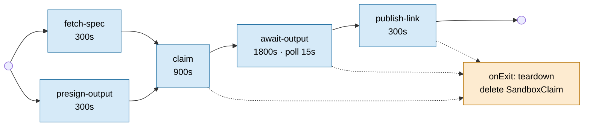

| Step | Does | Why it is on the hub, not in the VM |
|---|---|---|
| `fetch-spec` | Validates the key, reads the spec, derives the title, mints a run-scoped presigned GET | Needs `s3:GetObject` |
| `presign-output` | Mints presigned PUTs for the per-run staging key and the `FAILED` sentinel | Minting requires credentials the VM must never hold |
| `claim` | Creates a `SandboxClaim`, binds a warm pod, injects `DF_*` | Needs cluster RBAC |
| `await-output` | `HeadObject` poll for either object | The VM cannot be trusted to report its own success |
| `publish-link` | Mints the shareable presigned GET | Credentials |
| `teardown` | Deletes the claim so the pool recycles | Runs even on failure |

`onExit` is unconditional — a failed or deadlined run still releases its sandbox.

### Naming: the spec file is the document's identity

The published key mirrors the spec's own path below the input prefix:

| Uploaded spec | Published document |
|---|---|
| `specs/fleet-ops.md` | `docs/fleet-ops.html` |
| `specs/team/dash.md` | `docs/team/dash.html` |

Re-uploading the same filename **replaces** that document, so a shared link always
resolves to the current version. The relative path is kept rather than just the
basename so two specs with the same file name in different folders cannot silently
overwrite each other.

The coder still uploads to a per-run **staging** key, and `publish-link` copies it
to the named key only after the run succeeds. Two reasons this indirection is not
optional:

- A failed or abandoned run would otherwise destroy the version people already hold
  a link to.
- `await-output` treats "object exists" as "this run finished". Pointed at a stable
  name, the *previous* run's document satisfies the very first poll, and the
  workflow would publish stale output as a success.

Accepted limitation: two runs for the same filename with different content are not
serialised, because the workflow mutex is keyed on content. The named object is
replaced by a single atomic copy, so a reader never sees a partial document, but
with overlapping runs which one lands last is not defined.

---

## 4. Trust boundary and the credential model

The single most important diagram. The red boundary is the only place untrusted
model output executes.

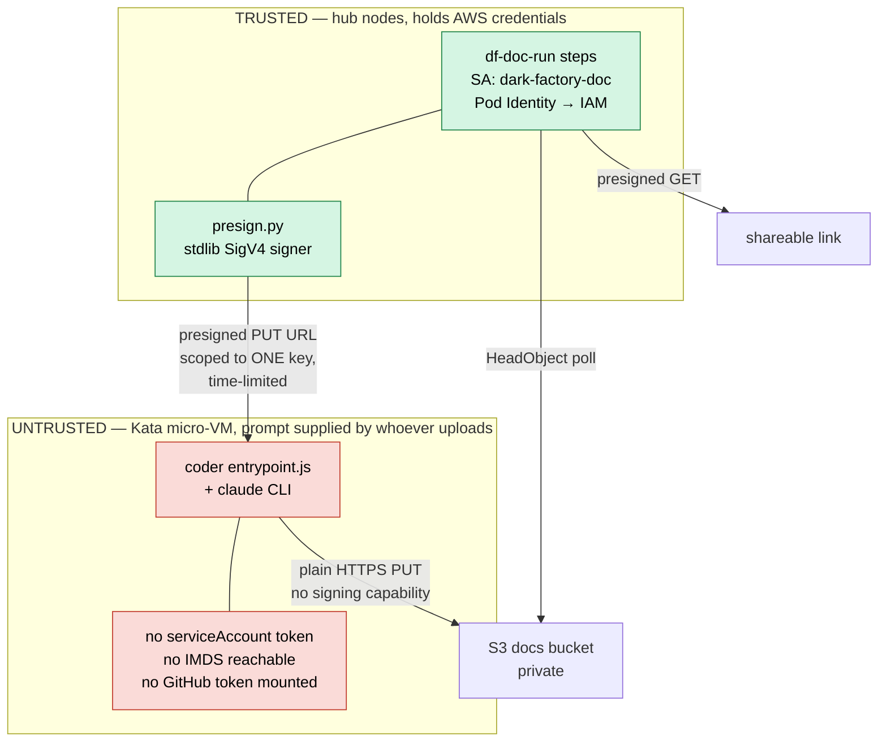

Enforced properties, each verified live:

| Property | Mechanism |
|---|---|
| No AWS credentials in the VM | `automountServiceAccountToken: false`, no service account, IMDS unreachable from the guest |
| Cannot write anywhere but its own object | Presigned PUT is scoped to one key and expires |
| Cannot read other runs' output | No bucket-wide permission exists to delegate |
| No GitHub write token | `doc-sandbox` omits the `coder-secrets` volume **and** the coder refuses to start if `GH_TOKEN_PATH` is readable |
| Cannot reach cluster-internal services | NetworkPolicy denies RFC1918; only the Bifrost ClusterIP is allowed |
| Cannot exhaust the account | Per-step deadlines, size ceilings, one claim per run |

Why this matters: the prompt comes from **anyone who can upload a file**. A
credential in that VM would be a credential handed to an untrusted prompt.

---

## 5. Sandbox internals and the network path

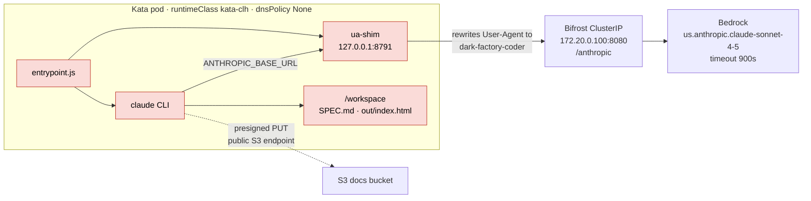

Three non-obvious constraints, all learned the hard way:

**`BIFROST_URL` must be the ClusterIP, never service DNS.** Kata pods run with
`dnsPolicy: None` and cannot resolve cluster DNS. The claim step's injected value
overrides the SandboxTemplate default.

**The ua-shim exists because Bifrost does User-Agent-prefix routing.** Any request
whose UA starts with `claude-cli` is run through a Claude-Code request transform
that is broken on this build and returns `400 Unexpected field type` regardless of
body. The shim rewrites the UA and transparently forwards everything, including SSE
streams. It must be a separate process — `execFileSync` blocks the Node event loop
for the whole run, so an in-process server would never accept a connection.

**Bifrost's default request timeout is 30 seconds.** Generation requests take up to
~110s, so every build failed with a 504 until `network_config.default_request_timeout_in_seconds: 900`
was set. Only trivially short completions fit the default — which is exactly why a
prose rendering succeeded and a real prototype build could not.

### Egress policy

Two NetworkPolicies apply to the doc pod, and NetworkPolicies are additive:

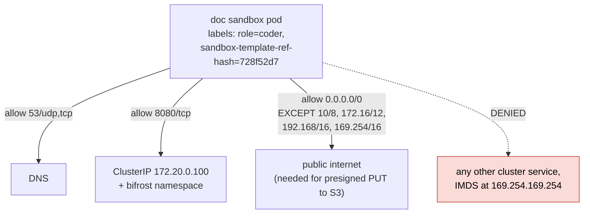

Blocking link-local (`169.254.0.0/16`) is what denies IMDS, closing the usual
credential-theft path out of a container.

### Container hardening

`runAsNonRoot: true` · `runAsUser: 1000` · `readOnlyRootFilesystem: true` ·
`allowPrivilegeEscalation: false` · `capabilities.drop: [ALL]` · seccomp profile ·
only `workspace` and `tmp` volumes. `$HOME` is redirected to `/tmp/coder-home`
because the root filesystem is read-only.

---

## 6. Kata node provisioning stack

This is the part that took four fixes beyond flipping the feature flags. Red nodes
mark where it breaks if a prerequisite is missing.

```mermaid
flowchart TB
    FLAGS["enabled-addons.yaml<br/>kata_nodepool: true<br/>agent_sandbox_kata: true"] --> NP["Karpenter NodePool<br/>kata-nested"]
    NP --> NC["EC2NodeClass kata-nested<br/>subnet discovery by tag"]
    NC -->|"FIX 1<br/>kro-ack VPCs tag subnets<br/>services.k8s.aws/namespace,<br/>not platform.gitops.io/cluster"| SUB["subnets resolved"]
    SUB --> NODE["c8i.2xlarge · nested virt<br/>labels kata-enabled=true,<br/>katacontainers.io/kata-runtime=true<br/>taint kata=true:NoSchedule"]
    NODE -->|"FIX 2<br/>Auto Mode gives self-managed<br/>nodes no CNI or kube-proxy"| ADDONS["vpc-cni + kube-proxy<br/>EKS addons"]
    ADDONS --> READY["node Ready"]
    READY --> KD["kata-deploy DaemonSet<br/>nodeSelector kata-enabled=true"]
    KD -->|"FIX 3<br/>nydus snapshotter setup restarts<br/>containerd, drops CNI, crashloops"| SNAP["snapshotter.setup: []"]
    SNAP --> SHIMS["installs clh + qemu shims,<br/>removes runtime-not-ready taint"]
    SHIMS --> RC["RuntimeClasses<br/>kata-clh · kata-qemu · kata-fc<br/>(owned by agent-sandbox chart)"]
    RC --> WP["SandboxWarmPools<br/>coder-warmpool · doc-warmpool"]
    WP -->|"FIX 4<br/>idle loop only released on<br/>DF_ISSUE_NUMBER, not DF_MODE"| BOUND["warm pod binds a claim<br/>and starts the coder"]

    classDef fix fill:#fadbd8,stroke:#c0392b,color:#000
    class SUB,ADDONS,SNAP,BOUND fix
```

Each failure is silent in a different way: a missing subnet tag leaves the
NodeClass `SubnetsNotFound` with no node ever requested; missing CNI leaves the
node `NotReady` forever; the nydus crashloop leaves the `runtime-not-ready` taint
in place so pods stay `Pending`; and the idle-loop gap lets the pod bind
**successfully** and then idle while the hub polls for a file nobody is writing.

---

## 7. Identity and IAM

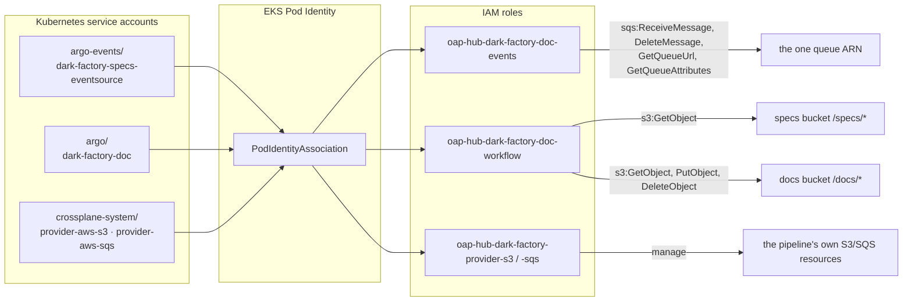

Every policy is prefix-scoped — no bucket-wide or queue-wide grants exist, so no
bucket-wide capability can be delegated into a presigned URL. `DeleteObject` is
granted solely to clear a stale `FAILED` sentinel before a rerun.

---

## 8. GitOps control plane

How a commit becomes running infrastructure. This chain has **three independent
repo pointers**; missing any one leaves part of the stack pointed at upstream.

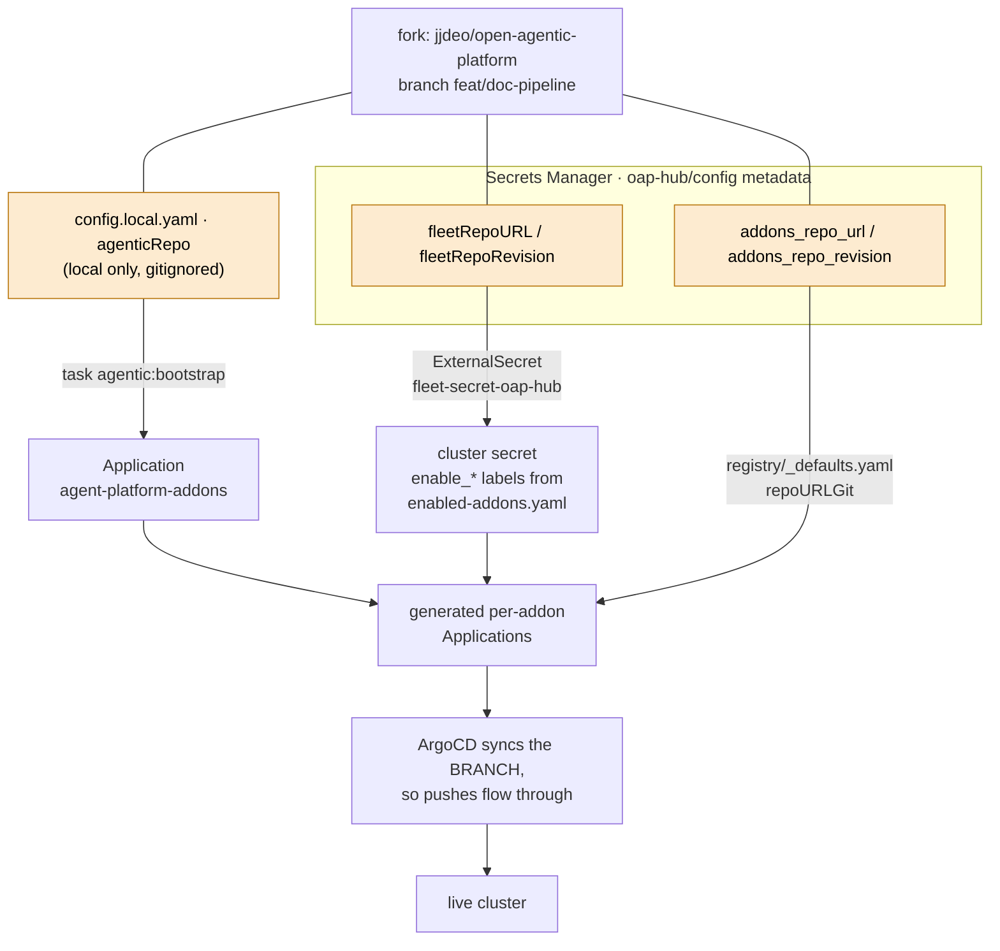

After editing Secrets Manager the ExternalSecret must be nudged, or the change sits
until its refresh interval:

```bash
kubectl --context oap-hub annotate externalsecret fleet-secret-oap-hub \
  -n argocd force-sync=$(date +%s) --overwrite
```

ArgoCD here is the **EKS managed capability**, not an in-cluster install — there
are no ArgoCD pods to exec into, and it is reached at its AWS-managed endpoint
rather than through the platform CloudFront distribution.

---

## 9. AWS resources created by the chart

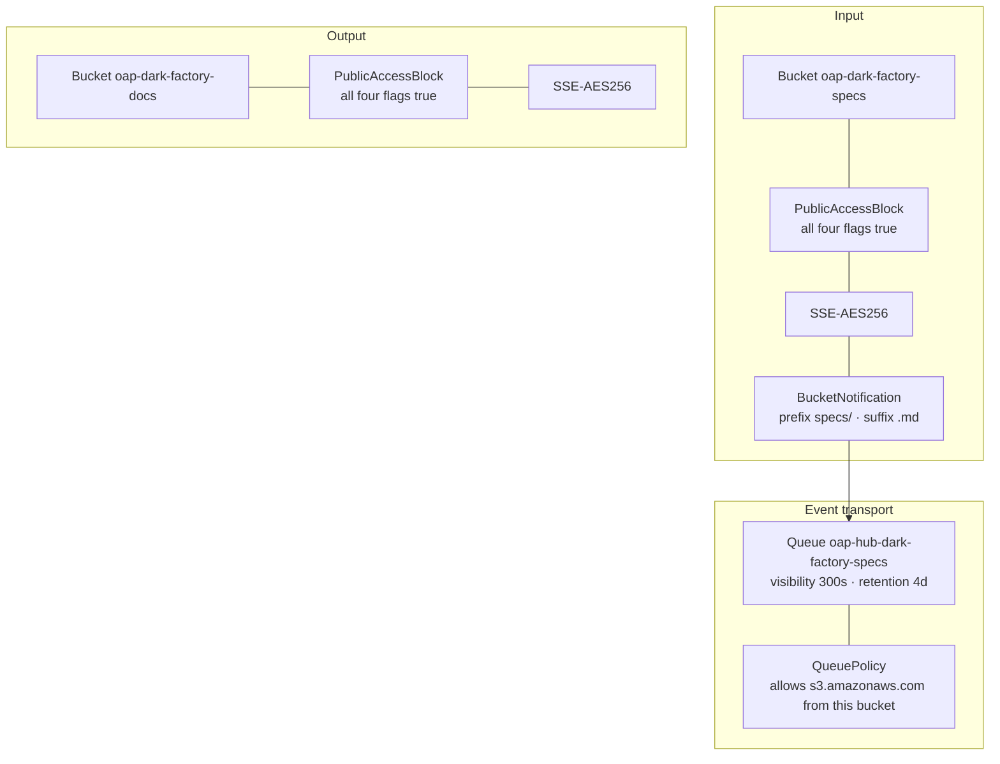

All nine resources are Crossplane managed resources and **must** carry
`argocd.argoproj.io/sync-options: SkipDryRunOnMissingResource=true` — without it a
first sync fails dry-run validation before the providers have installed their CRDs.

Argo Events has no AWS-S3 event source (its `s3` source speaks MinIO's protocol),
which is why SQS sits in the middle rather than S3 notifying the cluster directly.

---

## 10. Output validation and failure handling

The VM cannot be trusted to report its own success, so validation happens on both
sides of the boundary.

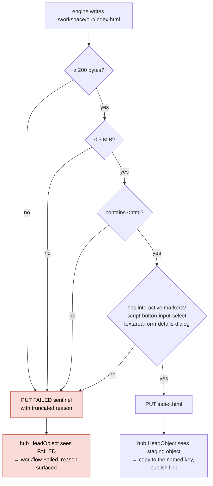

The interactive-marker check exists because a model given a prose-heavy spec will
happily return **the spec itself** as a styled article, which satisfies every other
check. That shipped once: a 3,419-byte document passed validation and published a
working link while being entirely the wrong kind of artifact. The marker set is
deliberately broad — a CSS-only prototype using `details`/`:checked` is legitimate,
so requiring `<script>` alone would reject valid work.

---

## 11. Verified reference run

| Property | Value |
|---|---|
| Workflow | `df-doc-5bfb411dca837811` |
| Spec | three-view "Fleet Ops Console" — summary tiles, bar chart, sortable/filterable table with detail panel, maintenance kanban |
| Output | **34,888 bytes**, `text/html` |
| Contents | 1 script block, 12 `addEventListener`, ~50 functions, 1 table, 5 inline SVGs, all three views, every spec-named feature |
| External references | **0** |
| Link | presigned GET, HTTP 200 |
| Longest gateway request | 109 s (would have 504'd under the 30 s default) |

For contrast, the earlier prose rendering was 3,419 bytes with zero interactive
elements.

---

## 12. Known gaps

| Gap | Consequence |
|---|---|
| `dark-factory-oap-hub` reports `OutOfSync/Degraded` on the SQS Queue only | Cosmetic — queue is `Synced`/`Ready` and the pipeline runs through it, but this app's health is not a usable signal until fixed |
| No bucket lifecycle rule | One output directory per run, kept forever |
| No SQS redrive/DLQ | A repeatedly failing message is retried until retention expires |
| A sandbox dying without writing either object | Not detected early; the run waits out `await-output` |
| Presigned link lifetime capped by the Pod Identity credential | Hours, not the configured 12h. CloudFront + OAC is the durable alternative |
| Model-authored HTML served from an S3 origin | No CSP can be set on an S3 object; treat output as untrusted content |
| Coder failures are hard to diagnose | The CLI runs with `stdio: inherit`, so `err.stderr` is null and the sentinel carries no reason; the real error lives in a pod log that podGC deletes |
